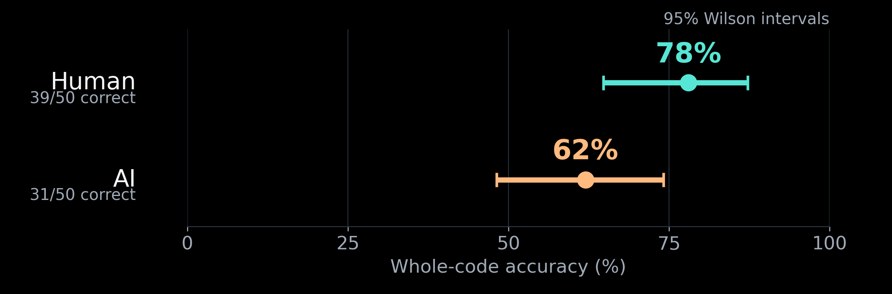
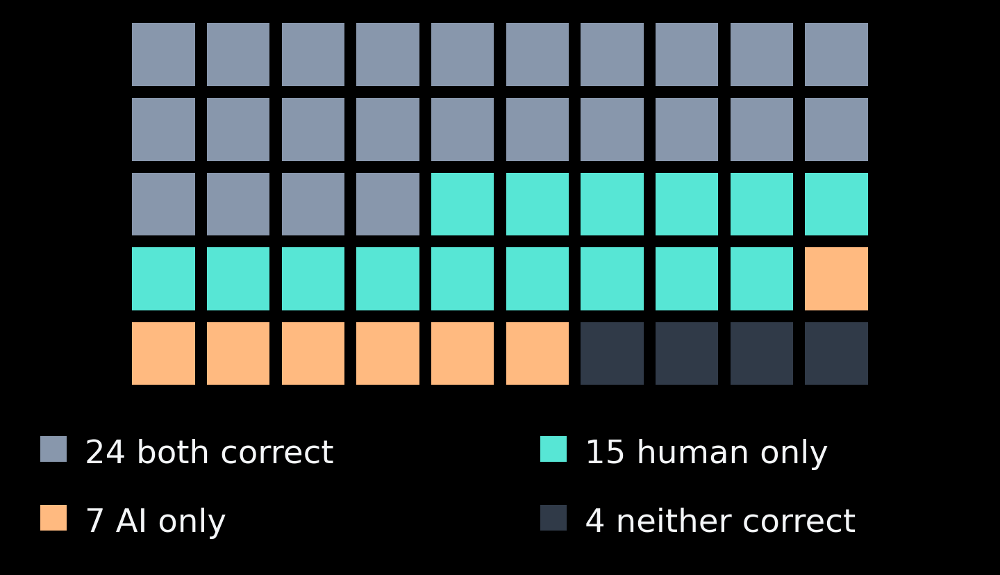
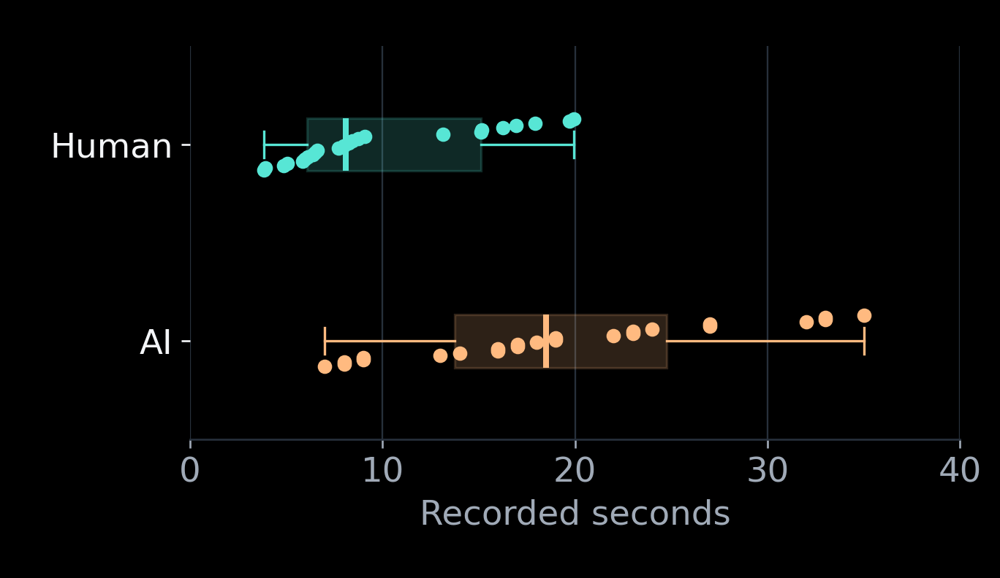

# Can humans read what AI misses?

**Module Project 2 · Statistical Analysis · [Snehal Jindal](https://github.com/snehal-jindal) & [Lexie Lin](https://github.com/Lexielinnnnn)**

We ran a paired experiment: 50 volunteers each read one striped six-character code, and GPT-6.1 Sol (medium effort) read the identical 50 images in fresh chats. This repository contains the complete frozen dataset, exact test images, feature engineering, analysis scripts, figures and presentation.

**Result:** humans read 39/50 codes correctly (78%); AI read 31/50 (62%). The observed human lead was **16 percentage points**, but the one-sided exact McNemar test was **not significant at 5%** (p = 0.0669). This does not prove equality or that the gap is “just noise.” It leaves the reliability of the apparent advantage uncertain.



## Start here

| What you need | Where to find it |
| --- | --- |
| Presentation | [PDF](presentation/slides.pdf) · [editable PPTX](presentation/slides.pptx) · [speaker notes](presentation/speaker_notes.md) · [live Google Slides](https://docs.google.com/presentation/d/1Af7olgmwciMVBlFlFfpIgUBnkoL-c-8pqziG3H6_AFM/edit) |
| Full statistical interpretation | [Methods, results and limitations](docs/analysis_interpretation.md) |
| Experimental design | [Protocol](docs/study_protocol.md) |
| **Feature engineering script** | **[scripts/feature_engineering.py](scripts/feature_engineering.py)** · [feature definitions](docs/feature_engineering.md) |
| Data | [raw](data/raw/responses.csv) · [cleaned](data/cleaned/responses_cleaned.csv) · [engineered features](data/processed/features.csv) · [dictionary](data/data_dictionary.md) |
| Exact 50 inputs | [PNG images](data/images/) · [checksummed manifest](data/image_manifest.json) |
| Sample-size / power calculations | [script](scripts/power_analysis.py) · [scenarios](results/power_sensitivity.csv) |
| Submission and collaboration status | [Rubric checklist](docs/submission_checklist.md) · [contribution workflow](CONTRIBUTING.md) |

## Research question and hypotheses

Can humans read these striped codes more accurately than the selected model under the specified testing procedures?

- **Null:** Humans and the selected AI model are equally accurate at reading striped codes.
- **Alternative:** Humans are more accurate than the selected AI model at reading striped codes.


One matched pair is an image, its human response and its AI response. There are **50 paired units**, not 100 independent observations. Humans had a 20-second limit; AI had no equivalent limit. This operational comparison must not be generalized to equal-time reading ability or all models.

## Reproduce in one command

Requires **Python 3.10 or newer**. No model API key, Google login, GPU, Node installation or paid service is needed to reproduce the analysis from the supplied observations.

```bash
git clone https://github.com/snehal-jindal/510-project2.git
cd 510-project2
python3 -m venv .venv
source .venv/bin/activate
python -m pip install -r requirements.txt
python scripts/run_analysis.py
```

On Windows, activate with `.venv\Scripts\activate` instead. For checks alone:

```bash
python -m unittest discover -s tests -v
python scripts/validate.py
```

The pipeline regenerates:

1. CSV export from the frozen raw JSON.
2. Cleaned values without dropping unsuccessful trials or filling missing times.
3. **Engineered correctness flags, matched categories, code-composition features and timing eligibility.**
4. Accuracy estimates, exact paired tests, effect sizes and confidence intervals.
5. Descriptive timing summaries and exploratory digit-count groups.
6. Exact-test power scenarios and all analysis figures.
7. Validation of image checksums, pair counts and agreement with presentation statistics.


## Which script does what?

| Script | Purpose |
| --- | --- |
| `export_data.py` | Converts the frozen connector export to CSV; it did not conduct the human experiment |
| `clean_data.py` | Standardizes IDs, case and numerical representation; retains recorded outcomes |
| **`feature_engineering.py`** | **Derives analysis-ready variables explicitly; see [documentation](docs/feature_engineering.md)** |
| `analyze_accuracy.py` | Exact one-/two-sided McNemar calculations, Wilson intervals, paired bootstrap interval and matched odds ratio |
| `summarize_timing.py` | Mean, median, spread and sample size; shared-success and own-success subsets kept separate |
| `power_analysis.py` | Reproducible hypothetical planning scenarios, not a claim of advance power justification |
| `make_figures.py` | Figures from generated data/results, including a clearly labeled exploratory digit plot |
| `validate.py` | Integrity and presentation-agreement checks |
| `run_analysis.py` | Executes the full pipeline in dependency order |

The original trials were conducted manually. Collection software from the earlier ant.ai project is archived separately in [collection/](collection/), pinned to its original commit. Reproduction of the **analysis** does not repeat human recruitment or new ChatGPT trials. Do not confuse those processes.

## Main findings

| Result | Estimate |
| --- | ---: |
| Human accuracy | 78% (39/50) |
| AI accuracy | 62% (31/50) |
| Human-only / AI-only success | 15 / 7 |
| Observed accuracy difference | +16 percentage points |
| Approximate 95% paired percentile-bootstrap interval | −2 to +34 points |
| One-sided exact McNemar p | 0.0669003 |
| Two-sided exact McNemar p, for transparency | 0.133801 |

See [machine-readable results](results/statistical_results.json) and [plain-English interpretation](docs/analysis_interpretation.md). The two p-values describe the same paired comparison; they are not independent discoveries or a choice made to obtain significance.





Timing is **descriptive only**. On 24 images both solved correctly, human mean/median were 9.98/8.11 seconds and AI mean/median were 19.54/18.50 seconds. AI values came from the interface’s “Worked for…” label, not a matching human stopwatch. A timing significance test would not fix this measurement problem.

## Limitations

Convenience recruitment at Duke library; mostly young volunteers in our convenience sample, with no formal age measurements; one model and effort setting; one attempt per fresh chat; unequal time allowances; missing strings for three recorded wrong human attempts; no ordinary-text control; and a power analysis performed after collection. The design was selected after pilot exploration. The results do **not** establish an AI-proof or deployable CAPTCHA.

Our written report will be linked here when finalized.

## Sources, provenance and assistance

- [Data and asset provenance](docs/provenance.md), including the original ant.ai commit and export dates.
- [References and credits](docs/references.md).
- [Cleaning decisions](docs/cleaning_log.md).
- We used AI assistance for coding, statistical checks and presentation preparation.
- [Reuse notice](NOTICE.md). Public visibility is not a blanket license for third-party materials.
