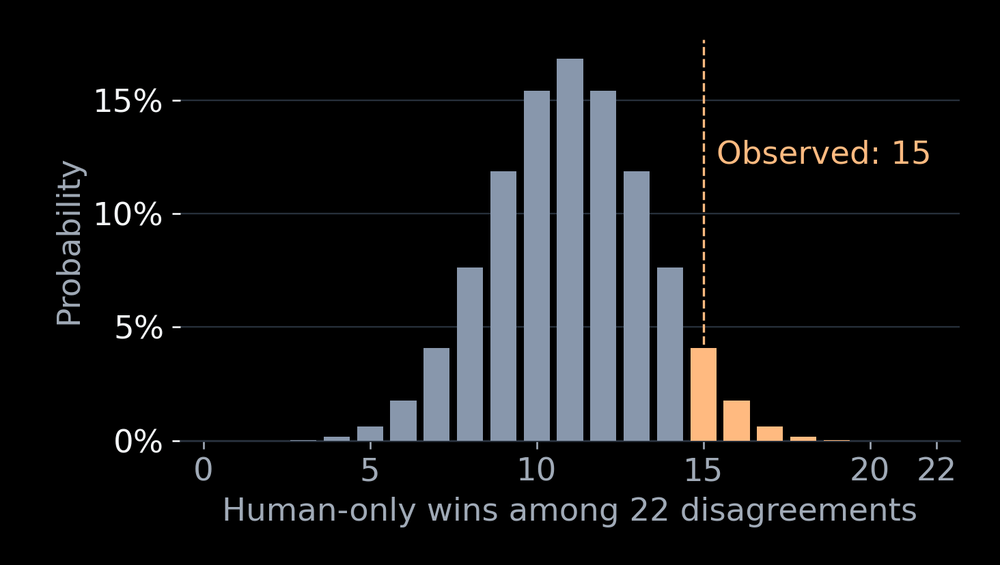
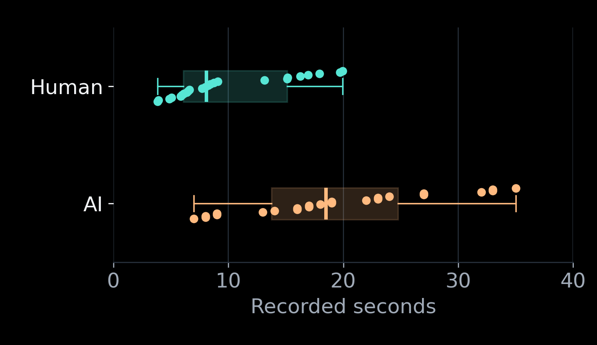
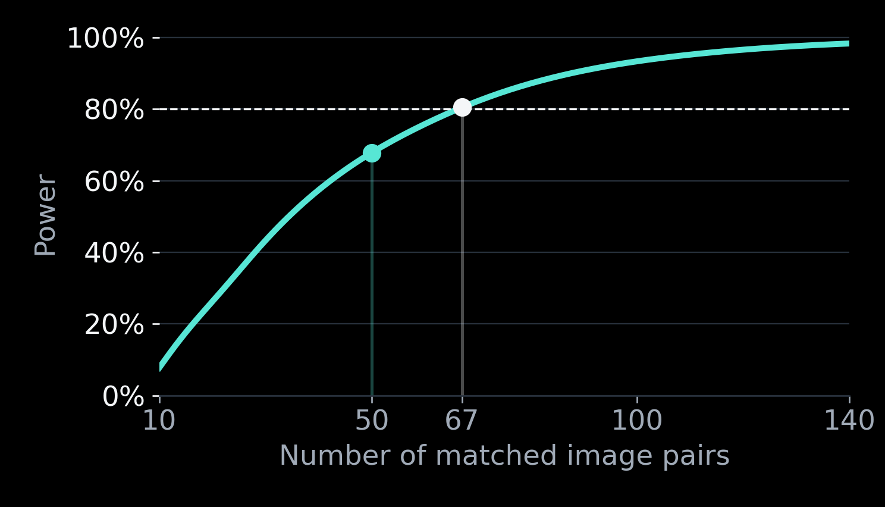

# Statistical analysis and interpretation

## What the data show

Humans succeeded on 39/50 images (78%); AI on 31/50 (62%). Both succeeded on 24; only humans on 15; only AI on seven; neither on four. The human-minus-AI accuracy difference is `(15−7)/50 = 0.16`, or **16 percentage points**, not a 16% relative improvement.

These are descriptive facts about the sample. Whether that gap reliably extends to new comparable observations is an inferential question.

## Primary test: exact McNemar

Each image has two binary outcomes, so an independent two-proportion test would discard matching. McNemar’s test uses discordant pairs. Under equal marginal accuracy, a disagreement is equally likely to favor either reader. Conditional on 22 disagreements, the number favoring humans follows `Binomial(22, 0.5)` under the null.

The directional alternative was human superiority. The exact one-sided p-value is the probability of at least 15 human-favoring disagreements: `sum(comb(22,k)/2**22 for k in range(15,23)) = 0.0669002533`. The corresponding two-sided exact result is 0.1338005066. The script uses SciPy `binomtest`; it does not apply a large-sample chi-square approximation.

At significance level 0.05, **fail to reject equal accuracy**. This is neither proof of equality nor proof the difference is “just noise.” A true advantage and sampling variation can both contribute to an observed gap. A p-value is not the probability the null is true or the probability a result is noise.

Assumptions: correctly matched and scored binary responses; independent sampling units across pairs; no repeated-person learning, coaching or shared-chat carryover. Independence across pairs is a design assumption, not something a normality test establishes. Binary outcomes need not be normally distributed. Convenience sampling and unequal time budgets remain limitations even with an exact calculation.

## Effect size and confidence intervals

The main effect size is the absolute 16-point accuracy difference. Its approximate two-sided 95% percentile-bootstrap interval is **−2 to +34 points**. Resample whole pairs, not human/AI outcomes independently. The implementation draws 200,000 multinomial samples of the four observed paired categories, equivalent for this statistic to resampling 50 original pairs with replacement. Seed: 20261102. These approximate bounds are discrete and are not an exact inversion of the one-sided test.

Each accuracy also has a Wilson 95% interval: human approximately 64.8–87.2%, AI 48.2–74.1%. Overlap of these individual intervals is not itself the paired hypothesis test.

An optional matched odds ratio is `15/7 = 2.14`. A Clopper–Pearson interval for the conditional human share of disagreements, transformed from probability to odds, gives approximately **0.82–6.21**. It includes the no-advantage ratio one. This is a complementary expression of the same uncertainty, not a separate positive finding. It does not mean humans are twice as accurate overall. The odds interval and bootstrap risk interval quantify different parameters.

The evidence leaves a small AI advantage through a substantial human advantage compatible with sampling uncertainty under the stated assumptions. The intervals do not quantify every form of recruitment or measurement bias.

## Timing: description, not a superiority test

For the **24 identical images both answered correctly**, human mean = 9.9779 s, median = 8.105 s, sample SD = 5.2525 s; AI mean = 19.5417 s, median = 18.5 s, SD = 8.5414 s. Shared-success and own-success summaries are separately labeled in `results/timing_summary.csv`.

Mean is the arithmetic average; median is the middle ordered observation. The boxplots show quartiles and individual times, not confidence intervals. Selecting shared successes can introduce selection bias and excludes the hard failures. Humans had a 20-second limit; AI did not. The displayed AI work label and recorded human elapsed time are not comparable clocks. A t-test or Wilcoxon test would not repair that measurement problem, so no reading-speed significance claim is made. Missing times are never zero-filled or treated as successful 20-second solves.

## Power: explicit retrospective planning scenarios

Power is the chance of rejecting the null when a specified alternative is true. It is not the probability our conclusion is correct. Power here depends on both the probability and direction of disagreements.

For independent pairs, assume human-only success probability 0.30 and AI-only success probability 0.10: a 20-point advantage, 40% disagreement rate and 75% human wins conditional on disagreement. For every possible number of disagreements `m ~ Binomial(n, .4)`, enumerate human wins `k ~ Binomial(m, .75)` and sum probabilities where the one-sided exact null tail is at most .05. This yields approximately **67.85% power at n=50** and **80.49% at n=67**.

| Assumed human-only / AI-only | Assumed gap | Power at 50 | First n reaching 80% |
| --- | ---: | ---: | ---: |
| .20 / .10 | 10 points | 27.8% | 199 |
| .25 / .10 | 15 points | 48.6% | 103 |
| .30 / .10 | 20 points | 67.9% | 67 |
| .35 / .10 | 25 points | 82.2% | 48 |

These are hypothetical scenarios **calculated after data collection**, not observed power offered as new evidence or an advance justification for 50. The 20-point planning target is not substituted for the observed 16-point estimate. A new study should select meaningful assumptions and sample size prospectively; 17 more observations are not guaranteed to produce significance. Do not continue this dataset until p falls below .05.

## Exploratory composition and error features

Digit-count groups are uneven: 0 digits n=11, 1 digit n=17, 2 digits n=13, 3 digits n=8, 5 digits n=1. AI accuracies are 45.5%, 70.6%, 61.5%, 75%, and 0%, respectively. There is no consistent downward trend. The singleton five-digit example cannot support a rule. No new confirmatory p-values are sought from these post hoc subgroups. There were no letter-O codes; O/X effects are untested. Missing human wrong strings prevent a complete human character-confusion comparison.

AI Levenshtein distance is provided as an exploratory feature for transcriptions, with abstentions marked missing rather than scored as literal text errors. It is not a human-AI character-accuracy endpoint, because wrong human strings were not fully recorded. A model giving up and a model misreading a character are distinct failures even though both count as unsuccessful for whole-code accuracy.

## Post hoc tests and practical meaning

No ANOVA or multiple-group omnibus test was used, so no post hoc pairwise tests are required for the primary two-reader comparison. The additional two-sided p-value, odds interval and Wilson intervals are transparent complementary summaries, not multiple independent confirmations. Adding tests purely to seek significance would weaken the analysis.

A significant accuracy difference would not by itself establish a secure CAPTCHA. AI still solved 62%; humans failed 22%. The current contribution is a measured, uncertain perceptual gap and a reproducible study—not a deployable security guarantee.

## Limits and recommendation

Convenience recruitment, one reported model/effort setting, selected stripe design, missing wrong-answer strings, unequal timing, no ordinary-text control and retrospective power planning limit conclusions. Fresh chats evaluate first-attempt behavior, not an informed attacker using hints, retries or image tools. More representative recruitment, controlled design variation, comparable timing, held-out challenges and prospective power planning are the appropriate next steps.
